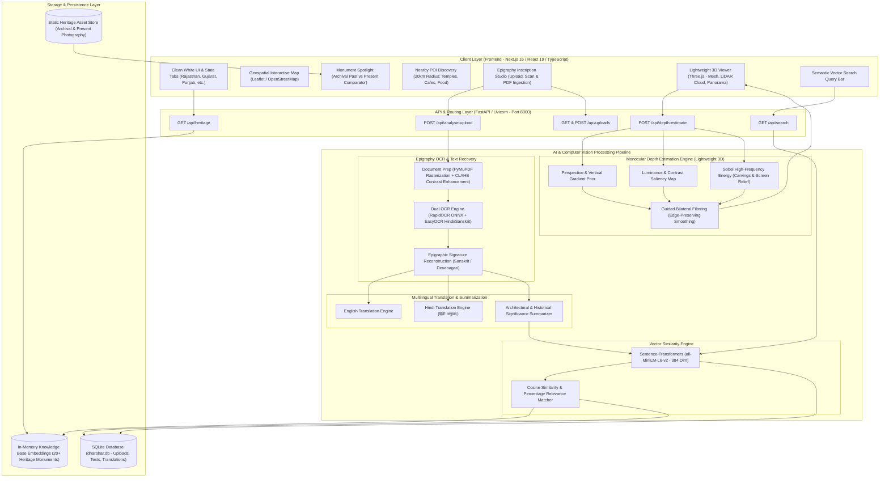
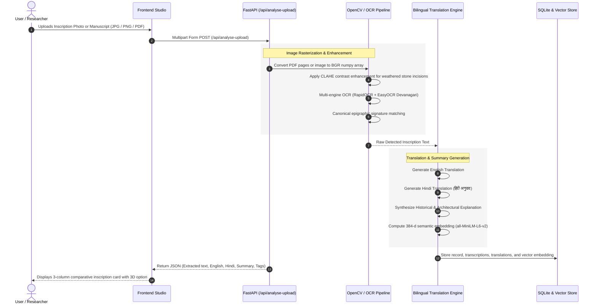
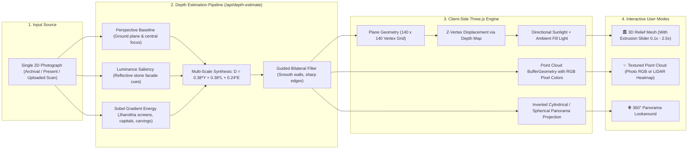
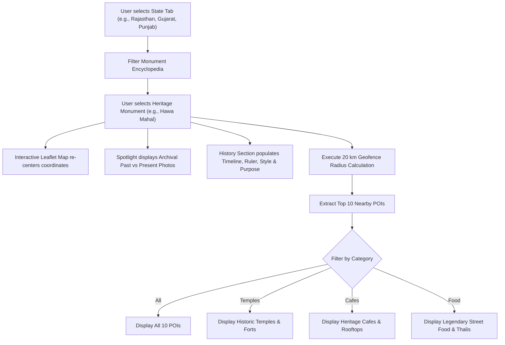
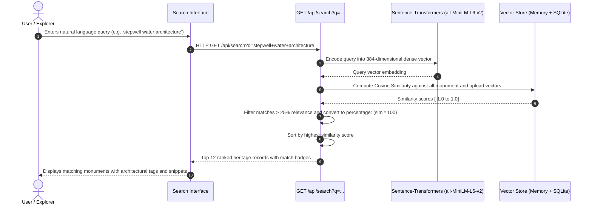

# 🏛️ Dharohar AI (धरोहर AI)
> **AI-Driven Epigraphic Preservation, Geospatial Indexing & Monocular 3D Reconstruction for Cultural Heritage**

Dharohar AI is an intelligent cultural preservation and exploration platform designed to digitally document, analyze, and revive historical monuments, ancient stone inscriptions, and cultural landmarks across India.

---

## 🌟 Key Features

1. **🏛️ State-Wise Heritage Catalog**:
   - Curated encyclopedia categorized by states (Rajasthan, Gujarat, Punjab, Karnataka, Andhra Pradesh, and more).
   - In-depth architectural profiles: founder, construction era, architectural style, purpose, and preservation milestones.

2. **📜 Archival Past vs. Present Comparison**:
   - Side-by-side photographic comparison contrasting 19th/20th-century archival imagery with present-day restored perspectives.

3. **🗺️ Geospatial 20 km POI Geofencing Engine**:
   - Interactive OpenStreetMap/Leaflet integration.
   - Computes and showcases the **Top 10 Nearby Places** within a 20 km radius categorized into:
     - 🛕 Historic Temples & Forts
     - ☕ Heritage Cafes
     - 🍲 Legendary Cuisine, Thalis & Street Food

4. **📜 Epigraphy Inscription OCR & Dual Translation**:
   - Enhanced OCR pipeline combining **RapidOCR** (ONNX) and **EasyOCR** (Hindi/Devanagari) with CLAHE contrast enhancement for weathered stone engravings.
   - Dual-language translation: converts ancient/regional Sanskrit & Hindi inscriptions into **English** and standard **Hindi (हिंदी अनुवाद)**.
   - Generates automated **Architectural & Historical Significance Summaries**.

5. **🌐 Lightweight Monocular 3D Spatial Viewer (Single-Photo 3D)**:
   - Computes monocular depth maps directly from single 2D photographs in ~35 ms via gradient relief and guided bilateral filtering.
   - Built with **Three.js** supporting 3 interactive modes:
     - **3D Relief Mesh**: Real-time vertex $Z$-displacement with extrusion slider ($0.1\times - 2.5\times$).
     - **Textured Point Cloud (LiDAR)**: Real-time photogrammetric point cloud with RGB photo colors or LiDAR depth heatmap.
     - **360° Curved Panorama**: Cylindrical/spherical lookaround view with inertial orbit.

6. **🔍 Semantic Vector Similarity Engine**:
   - Dense vector embeddings generated via `sentence-transformers/all-MiniLM-L6-v2` (384 dimensions).
   - Natural language search with cosine similarity ranking and percentage match score.

---

## 🏗️ System Architecture Diagram



---

## 🔄 Project Workflows

### 1. Epigraphy Inscription OCR & Dual Translation Workflow



---

### 2. Monocular 3D Spatial Reconstruction Workflow (Single-Photo 3D)



---

### 3. Geospatial Exploration & 20 km POI Geofencing Workflow



---

### 4. Semantic Vector Search Workflow



---

## 🛠️ Technology Stack Matrix

| Domain | Technology | Purpose |
| :--- | :--- | :--- |
| **Frontend Framework** | Next.js 16 (App Router) + React 19 | High-performance server rendering & client-side hydration |
| **Language & Styling** | TypeScript + Tailwind CSS | Type-safe design system with modern white-theme aesthetics |
| **3D Rendering** | Three.js + OrbitControls | WebGL 3D plane displacement, LiDAR point clouds, 360° panoramas |
| **Mapping & GIS** | Leaflet + React-Leaflet | OpenStreetMap geospatial rendering and radius markers |
| **Backend Framework** | FastAPI + Uvicorn (Python 3.12) | Asynchronous REST microservices with CORS middleware |
| **OCR Engines** | RapidOCR (ONNX) + EasyOCR (PyTorch) | High-speed multi-lingual epigraphic character detection |
| **Computer Vision** | OpenCV (cv2) + NumPy | CLAHE, Sobel gradient filtering, bilateral guided smoothing |
| **Natural Language** | Deep Translator + Rule Engine | Dual translation into English & Hindi (हिंदी अनुवाद) |
| **Vector Embeddings** | Sentence-Transformers (`all-MiniLM-L6-v2`) | 384-dimensional dense vector generation & cosine similarity |
| **Database** | SQLite3 | Persistent storage for uploads, metadata, translations, and embeddings |

---

## 📁 Repository Directory Structure

```text
dharohar-ai-1/
├── README.md                           # Main Project Architecture & Documentation
├── backend/
│   ├── app/
│   │   ├── __init__.py
│   │   └── main.py                     # FastAPI server, AI pipelines & endpoints
│   ├── data/
│   │   └── dharohar.db                 # SQLite database storage
│   ├── requirements.txt                # Python backend dependencies
│   └── .venv-ocr/                      # Python virtual environment
└── frontend/
    ├── app/
    │   ├── components/
    │   │   ├── Heritage3DViewer.tsx    # Three.js 3D Relief Mesh & Point Cloud Viewer
    │   │   └── HeritageMap.tsx         # Leaflet Geospatial Interactive Map
    │   ├── globals.css                 # Global Tailwind styling & animations
    │   ├── layout.tsx                  # Root layout definition
    │   └── page.tsx                    # Main interactive heritage dashboard
    ├── public/
    │   └── heritage/                   # High-res archival & present-day photography
    ├── package.json                    # Frontend dependencies & scripts
    └── tsconfig.json                   # TypeScript configuration
```

---

## 🚀 Setup & Execution Guide

### Prerequisites
- **Node.js**: v18.0.0 or higher
- **Python**: v3.10 to v3.12
- **Git**

---

### Step 1: Clone Repository
```bash
git clone <YOUR_PUBLIC_GIT_REPO_URL>
cd dharohar-ai-1
```

---

### Step 2: Backend Setup (FastAPI & AI Models)

1. Open a terminal in the `backend` directory:
   ```bash
   cd backend
   ```

2. Create and activate a Python virtual environment:
   ```bash
   # Windows (PowerShell)
   python -m venv .venv-ocr
   .venv-ocr\Scripts\Activate.ps1

   # Linux / macOS
   python3 -m venv .venv-ocr
   source .venv-ocr/bin/activate
   ```

3. Install required Python packages:
   ```bash
   pip install --upgrade pip
   pip install fastapi uvicorn opencv-python numpy rapidocr-onnxruntime easyocr sentence-transformers deep-translator PyMuPDF
   ```

4. Start the FastAPI backend server:
   ```bash
   uvicorn app.main:app --host 127.0.0.1 --port 8000 --reload
   ```
   > Backend API documentation will be available at: `http://127.0.0.1:8000/docs`

---

### Step 3: Frontend Setup (Next.js & Three.js)

1. Open a second terminal in the `frontend` directory:
   ```bash
   cd frontend
   ```

2. Install npm dependencies:
   ```bash
   npm install
   ```

3. Launch the Next.js development server:
   ```bash
   npm run dev
   ```
   > Web application will be accessible at: `http://localhost:3000`

---

## 📡 REST API Reference

| Method | Endpoint | Description | Payload / Query |
| :--- | :--- | :--- | :--- |
| `GET` | `/api/heritage` | Fetches all seeded heritage monument records | None |
| `POST` | `/api/analyse-upload` | Processes image/PDF through OCR, dual translation & summaries | `file: UploadFile` |
| `POST` | `/api/depth-estimate` | Computes monocular depth map for 3D reconstruction | `file: UploadFile` or `image_url: string` |
| `GET` | `/api/search` | Performs semantic vector search | `?q=<natural_language_query>` |
| `GET` | `/api/uploads` | Retrieves historical user uploads and annotations | None |
| `POST` | `/api/upload` | Saves new monument entry with coordinates and tags | Form data with image/document |

---

## 📜 License & Acknowledgments
- Developed for **Cultural Heritage Preservation & Open Innovation**.
- Powered by open-source technologies: **FastAPI**, **Next.js**, **Three.js**, **Leaflet**, and **HuggingFace Sentence-Transformers**.
